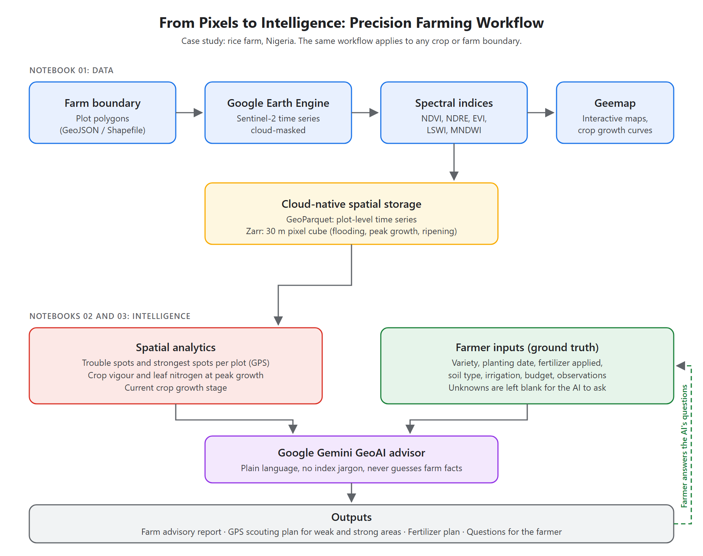

# From Pixels to Intelligence: Precision Farming with Google Earth Engine and Google GeoAI

A satellite remote sensing and artificial intelligence workflow for precision farming. It integrates multi-spectral Sentinel-2 satellite data, Geemap interactive visualization, cloud-native spatial storage (GeoParquet and Zarr), and Google GeoAI (Gemini) to monitor crop health, track phenology and generate field-level agronomic advice.

**Case study:** a rice farm in Nigeria is used to demonstrate the workflow. The same approach applies to any crop or farm boundary; swap in your own `farm_boundary` and adjust the indices and prompts.

**Slides:** [From Pixels to Intelligence.pptx](assets/From%20Pixels%20to%20Intelligence.pptx)

## Workflow



This practical session is organized into three hands-on notebooks:

1. Data Extraction, Geemap and Spatial Storage:
   notebooks/01_rice_farm_data_and_indices.ipynb
   Extracts Sentinel-2 time series, computes indices (NDVI, NDRE, EVI, LSWI, MNDWI), explores all spectral layers interactively on Geemap over the farm boundary, plots phenology trajectories, and exports to GeoParquet and a pixel-level spatial Zarr cube.

2. Whole-Farm GeoAI Agronomic Advisor:
   notebooks/02_rice_farm_geoai_expert.ipynb
   Pure AI hands-on session. Feeds multi-spectral satellite telemetry to Google Gemini (using the API key from .env), delivering clear, jargon-free agronomic advice for farmers (no cryptic formulas or raw decimals) and answering two targeted operational farmer questions cell-by-cell.

3. Pixel-Level Spatial GeoAI Scouting Expert:
   notebooks/03_pixel_level_zarr_geoai_analysis.ipynb
   Pure AI spatial scouting session. Connects Google Gemini to 30 m pixel-level telemetry to find both trouble spots and the strongest, healthiest spots in every plot, with Plot IDs, sectors/corners and exact GPS coordinates. Adds farmer-provided ground truth (variety, fertilizer already applied, soil, budget), generates a fertilizer plan, and lets the AI ask the farmer for missing information instead of guessing, then refine its advice once the farmer answers.

---

## Configuration and Environment (.env)

Add your credentials to .env:

```env
# Google Earth Engine Configuration
GEE_PROJECT_ID=ee-adedoyinsamuel25
GEE_SERVICE_ACCOUNT_KEY=./credentials/ee-adedoyinsamuel25-5674f2f97650.json

# Google GeoAI / Gemini API Key
GEMINI_API_KEY=your_key_here
GOOGLE_API_KEY=your_key_here
GEOAI_MODEL=gemini-3.5-flash-lite
```

---

## Quick Start

Launch Jupyter Notebook and open the notebooks in order:

```bash
jupyter notebook notebooks/01_rice_farm_data_and_indices.ipynb
```
